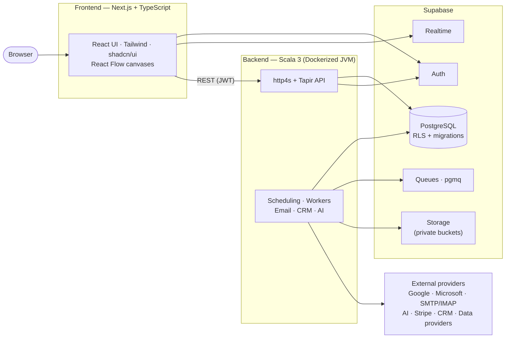

# Arcadence

**AI-powered outreach & sales engagement platform** — a production-oriented, multi-tenant SaaS for cold-email outreach, B2B lead management, campaign automation, unified inbox, CRM, deliverability intelligence, analytics, and AI-assisted sales workflows.

> **Status:** Foundation phase. The repository, engineering conventions, and documentation set are established; implementation proceeds phase-by-phase (see [docs/PROJECT_STATUS.md](docs/PROJECT_STATUS.md)).

---

## Architecture at a glance



**Key principles**

- **Multi-tenancy is enforced twice:** Row-Level Security in Supabase *and* independent workspace authorization in the Scala API. The service-role key never reaches the browser.
- **Durable by default:** background work runs on PostgreSQL-backed queues/outbox with idempotent processing; email submission treats unknown outcomes as unknown (at-least-once, never assumed exactly-once).
- **Compliance first:** consent, suppression, and opt-out are first-class features. No mechanisms intended to evade email-provider abuse controls.

## Technology stack

| Layer | Technology |
| --- | --- |
| Backend | Scala 3 · sbt · Cats Effect · http4s · Tapir · Doobie |
| Frontend | Next.js App Router · React · TypeScript · Tailwind CSS · shadcn/ui · React Flow |
| Database & platform | Supabase (PostgreSQL, Auth SSR, Storage, Realtime, pgmq queues) |
| Payments | Stripe |
| Testing | ScalaTest/MUnit · Vitest · Playwright · integration tests |
| Deployment | Dockerized JVM services on VPS/container host · Vercel for the frontend |

## Repository layout

```
├── AGENTS.md            # Binding instructions for coding agents — read first
├── docs/                # Permanent project documentation
│   ├── PROJECT_STATUS.md    # Phase/subphase status (single source of truth)
│   ├── ARCHITECTURE.md      # System design
│   ├── DECISIONS.md         # Architecture decision records
│   ├── DATABASE.md          # Schema overview & migration conventions
│   ├── API.md               # API conventions & endpoint docs
│   ├── SETUP.md             # Local development setup
│   ├── MANUAL_SETUP.md      # External account tasks for the product owner
│   ├── HANDOFF.md           # Implementation/handoff log
│   └── SECURITY.md          # Security posture & decisions
├── backend/             # Scala 3 modular monolith (API + worker) — Phase 0
├── frontend/            # Next.js App Router application — Phase 0
├── supabase/            # SQL migrations & project config — Phase 0
└── .github/             # PR/issue templates, CI (planned Phase 0)
```

## Branch model

- `main` — protected release branch; promoted from `develop` per completed phase.
- `develop` — integration branch; all feature work lands here via PR.
- `feature/phase-NN-slug` — one branch per subphase, conventional commits.

## Contributing / agent workflow

All work follows [AGENTS.md](AGENTS.md): one prompt → one completed subphase → tests → push → implementation report. See [CONTRIBUTING.md](CONTRIBUTING.md) for the short version.

## License

Proprietary — © 2026 Arcadence. All rights reserved. Not licensed for redistribution.
