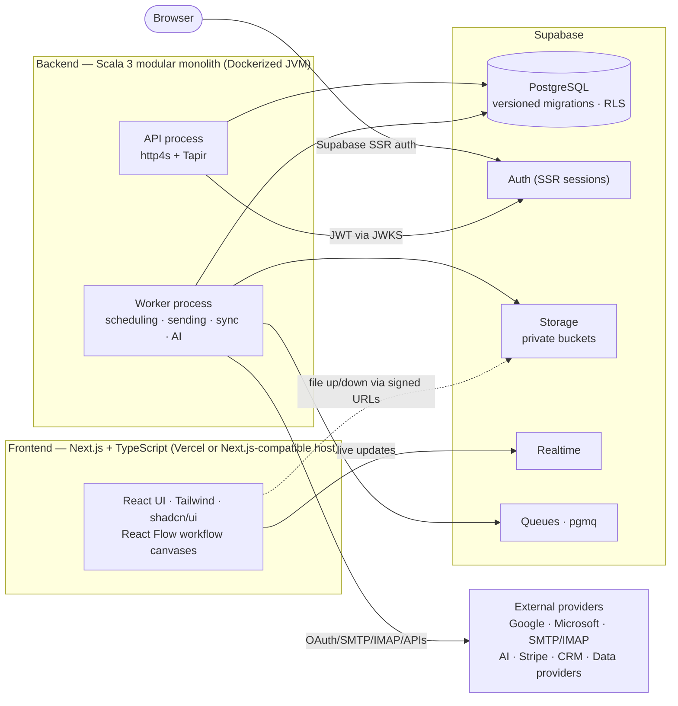
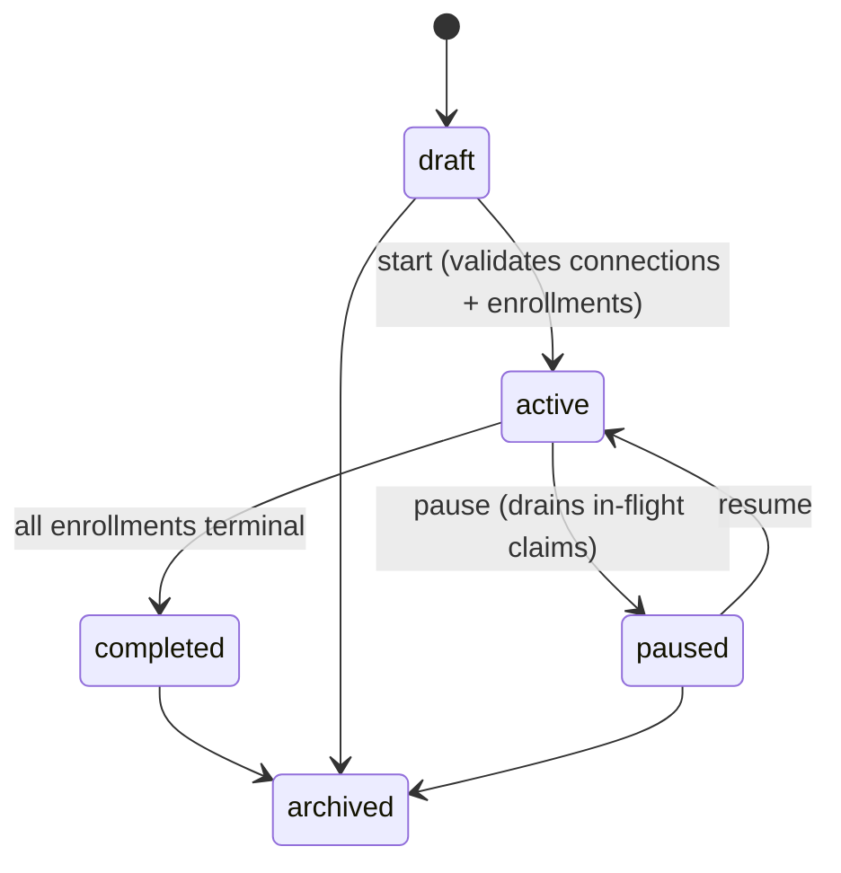
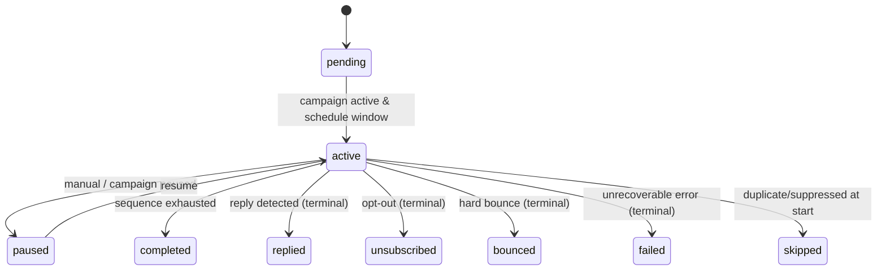
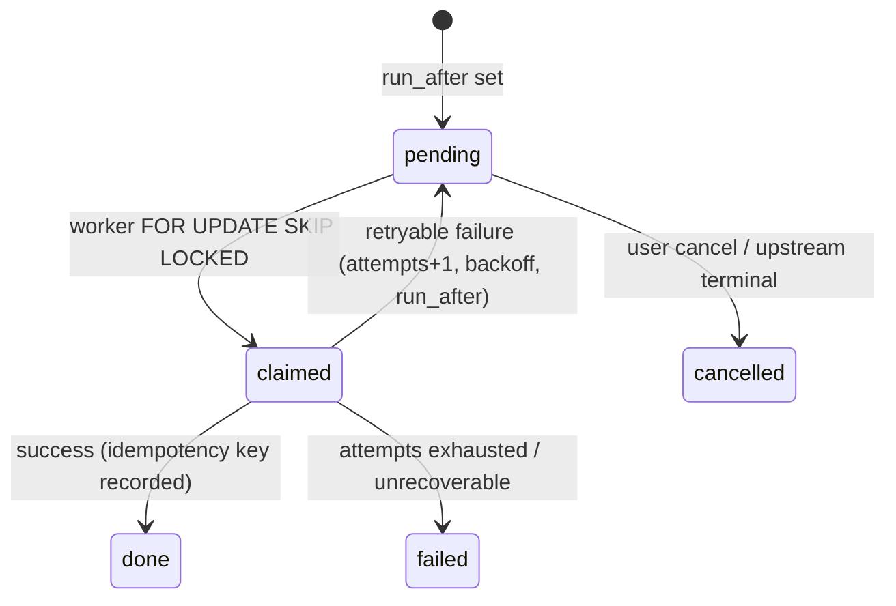
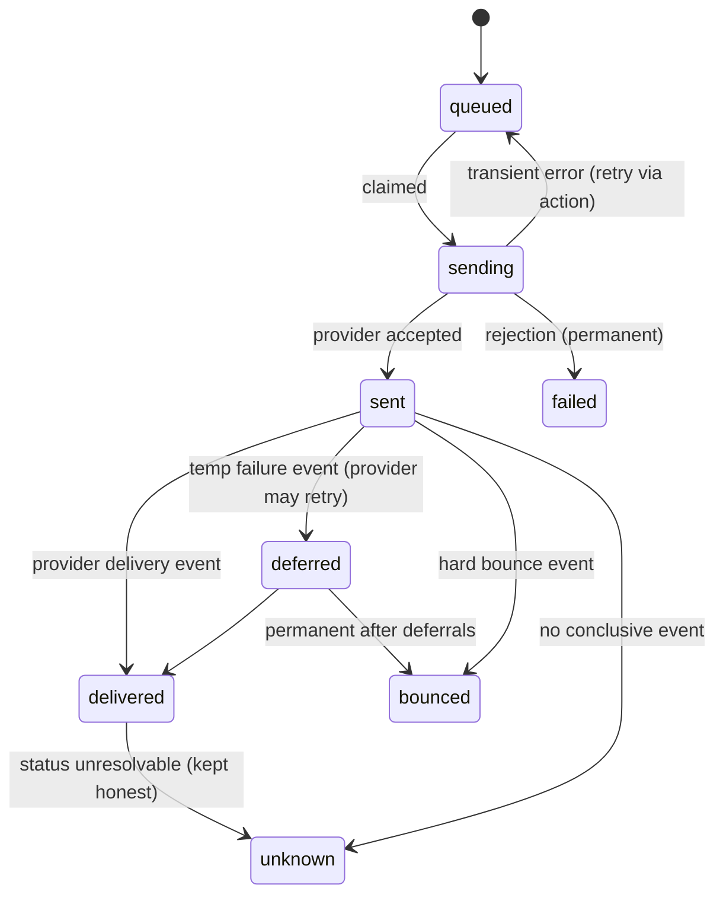
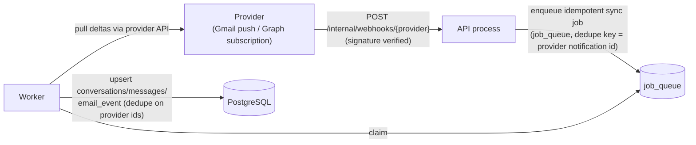
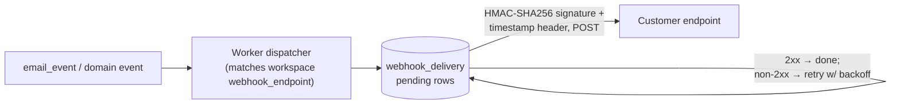

# Arcadence — System Architecture

> Status: **Foundation + design (Phase 0.1–0.2).** Sections 1–6 are implemented as marked; sections 7–8 (state machines, webhook flows) and the module ownership model are the Phase 0.2 design that Phases 1+ implement.

---

## 1. System context

## 2. Components

### 2.1 Frontend — Next.js App Router

- **React 19 + TypeScript**, server components by default, client components where interactivity demands.
- **Tailwind CSS + shadcn/ui (Radix primitives)** for accessible, themeable components. Design language per `AGENTS.md` §6: sophisticated minimalism, subtle spatial depth, restrained neumorphism, indigo/navy palette, light+dark themes.
- **React Flow** for campaign/automation workflow canvases.
- **Supabase Auth SSR** for session management; only public (`NEXT_PUBLIC_*` / publishable) configuration reaches the browser.
- **Supabase Realtime** subscribes the browser directly to customer-facing live updates (inbox, campaign progress) where suitable.
- Every feature ships loading, success, empty, validation, error, and permission-denied states.

### 2.1b Provider adapter layer (Phase 2, in `arcadence-core`)

- **`EmailProvider` trait** — the single contract every provider adapter implements: authorization completion, connection validation, message submission, threaded replies, inbox synchronization (cursor-based), health checks, token refresh, and access revocation. Adapters return typed `ProviderError` values (invalid credentials / permission denied / rate limited / throttled / unreachable) — never exceptions across the boundary.
- **Capability matrix** (`ProviderCapabilities`) — what each provider supports (send, inbox sync, replies, token refresh, health checks) declared separately from the adapter; the API capability endpoint and the dashboard connect cards render from this matrix, never from hardcoded UI assumptions.
- **Account state machine** (`EmailAccountStatus`) — `connected / reconnect_required / rate_limited / suspended / error / disconnected` with an explicit legal-transition matrix enforced API-side; transitions write `account_health_events` (the dashboard health trail) and are audited.
- **Credential encryption** (`CredentialEncryptor`, ADR-0020) — AES-256-GCM; adapters persist secrets only through the caller-provided store callback, so adapter code never touches ciphertext or keys.
- Status: contract, matrix, state machine and encryptor (Phase 2.1), the **Gmail adapter** (2.2, ADR-0021) and the **Microsoft Graph adapter** (`com.arcadence.core.email.microsoft.GraphProvider` — tenant-aware OAuth + PKCE, draft-then-send so provider message ids are captured, skip-token inbox listing with a `/delta` + change-notification path designed in, `revokeSignInSessions` revocation; ADR-0022) are implemented and tested against stub provider servers (all endpoints injectable — full flow tests run without network). and the **SMTP/IMAP adapter** (`com.arcadence.core.email.smtpimap.SmtpImapProvider` — Jakarta Mail/angus, mandatory ssl/starttls, server-side credential validation, UID-cursor inbox; ADR-0023, GreenMail-verified) complete the matrix (Phase 2).

### 2.2 Supabase (platform of record)

| Capability | Usage |
| --- | --- |
| PostgreSQL | System of record; all schema via version-controlled SQL migrations; RLS on every tenant table (`docs/DATABASE.md`) |
| Auth | User identity, SSR sessions; Scala verifies JWTs via Supabase JWKS |
| Storage | Private buckets for imports, attachments, exports; access only through signed URLs generated server-side |
| Realtime | Customer-facing live updates where appropriate (inbox, campaign progress) |
| Queues (pgmq) | Durable queues where queue semantics beat job tables; else `job_queue`/outbox tables (ADR-0005) |

**Connection policy (ADR-0018):** Scala services are long-lived JVM processes → direct connections (5432) or session pooling. Transaction pooling (6543) only for short-lived request paths, with prepared statements disabled (`prepareThreshold=0`) and no cross-transaction session assumptions.

### 2.3 Backend — Scala 3 modular monolith

One deployable codebase, **two runnable processes**:

- **API process** — http4s HTTP server, Tapir-derived endpoints + OpenAPI, request validation, authorization, orchestration. Owns all *interactive, latency-sensitive* paths.
- **Worker process** — durable job execution. Owns everything *background or provider-facing*: scheduling, sending, syncing, rollups, AI pipelines, webhook deliveries.

**Stack (pinned — ADR-0016):** Scala 3.3.8 (LTS), sbt 1.12.15, Cats Effect 3.7.1, http4s 0.23.38 (ember) — the stable line; Tapir 1.13.33's own POM targets it and the 1.0 series is still milestone-only — Tapir 1.13.33, Doobie 1.0.0-RC12, PostgreSQL JDBC 42.7.14, log4cats 2.8.0 + logback 1.6.5.

### 2.4 Module boundaries & ownership (Phase 0.2 design)

Modules are package-level boundaries inside one build; each module **owns its tables** (no other module writes them directly) and exposes services to the rest of the monolith.

| Module | Owns (tables) | API-process responsibilities | Worker-process responsibilities |
| --- | --- | --- | --- |
| `identity` | `profile` | Session resolution, current-user context | — |
| `workspaces` | `organization`, `workspace`, `workspace_member`, `invitation` | Workspace CRUD, member/invite flows, RBAC resolution | Invite emails (later), membership audit |
| `emailconnections` | `email_connection`, `email_credential` | Connect flows (OAuth start/callback, SMTP forms), status display, test-send | OAuth token refresh, connection health checks |
| `leads` | `company`, `contact`, `custom_field`, `contact_list`, `contact_list_member`, `suppression` | CRUD, import/export (CSV via signed URLs), search, verification hooks | Verification batching, import processing, list math |
| `campaigns` | `campaign`, `campaign_email_connection`, `sequence_step`, `sequence_step_variant`, `enrollment`, `scheduled_action` | Campaign/sequence CRUD, enrollment management, start/pause | **Send scheduler** (materialize `scheduled_action` from enrollments), enrollment state machine |
| `sending` | `message` (outbound subset), `email_event` | Send status display, per-message detail | **Sender** (claims due actions, provider adapters, idempotent submission), bounce/complaint processing, open/click tracking ingress |
| `inbox` | `conversation`, `message` (inbound subset), reply composition | Unified inbox reads, reply send, read/star states | **Inbound sync** (Gmail API/Graph/IMAP), threading, reply matching to enrollments |
| `crm` | `pipeline`, `pipeline_stage`, `crm_deal`, `crm_activity` | Pipeline/deal/activity CRUD | Reply→deal activity linking, stage automation (later) |
| `deliverability` | (reads `email_event`, owns guidance config later) | Reputation dashboards, guidance | Deliverability signal computation |
| `analytics` | `campaign_stats_daily` | Rollup reads, report endpoints | **Daily/hourly rollups** from `email_event` |
| `ai` | `ai_generation` | Assisted-copy/reply/summary endpoints (audit every generation) | Async generation jobs, provider calls, usage metering |
| `billing` | `plan`, `subscription`, `usage_counter` | Plan/limit reads, checkout/session routing (Stripe) | Stripe webhook ingestion (idempotent), usage counters |
| `platform` | `job_queue`, `audit_log`, `webhook_endpoint`, `webhook_delivery` | Health/readiness, outbound-webhook registration | Job runner core, audit writers, **outbound webhook dispatcher**, retention |

Cross-module rules: modules communicate through in-process service calls (no network hops); a module reaching into another's tables is a review-blocking defect; shared kernel types (errors, tenancy context, clock) live in `platform`/`core`.

### 2.5 External providers

Google (Gmail API), Microsoft (Graph), arbitrary SMTP/IMAP, AI providers, Stripe, CRMs, and B2B data providers. All integrations sit behind module-level adapters so providers are replaceable; provider credentials are stored encrypted (see `docs/SECURITY.md` §4).

## 3. Multi-tenancy & authorization model (ADR-0017)

- Every tenant is a **workspace** (`workspace.id`); workspaces belong to an **organization** (billing owner). All domain rows carry `workspace_id` (`docs/DATABASE.md` §2).
- **Defense in depth:**
  1. **RLS policies** in PostgreSQL scope every table to the caller's workspace via helper functions (`is_workspace_member`, `workspace_role` — `docs/DATABASE.md` §9).
  2. **Scala-side authorization** independently resolves caller → user → membership → role for the workspace addressed by the request. Service-role usage is enumerated and never substitutes for tenant checks.
- **Role matrix (initial):**

  | Capability | owner | admin | campaign_manager | member | viewer |
  | --- | --- | --- | --- | --- | --- |
  | Manage workspace, billing | ✅ | — | — | — | — |
  | Manage members & invitations | ✅ | ✅ | — | — | — |
  | Manage campaigns | ✅ | ✅ | ✅ | — | — |
  | Manage email connections, suppression, exports | ✅ | ✅ | — | — | — |
  | Leads/inbox/CRM read-write | ✅ | ✅ | ✅ | ✅ | — |
  | Read-only access | ✅ | ✅ | ✅ | ✅ | ✅ |

  Enforcement lives in `Permissions.scala` (role → permission set, single source of truth); endpoints name permissions, never roles.

- **404 vs 403:** resources in other workspaces are `404` (never confirm existence); insufficient role inside the workspace is `403`.
- **Cross-tenant isolation tests** are mandatory for every new resource (ADR-0011).

## 4. Data flow patterns

- **Request path:** Browser → Next.js (SSR auth session) → Scala API (JWT verified via JWKS, tenant check) → PostgreSQL (RLS as backstop).
- **Command/side-effect path:** API writes an intent row (`scheduled_action`, `job_queue`, `webhook_delivery`) → worker claims with `FOR UPDATE SKIP LOCKED`, executes with idempotency keys → outcomes recorded as append-only events; retries with backoff; unknown outcomes recorded as unknown — never assumed delivered or failed (ADR-0005).
- **Live path:** worker/API writes → Supabase Realtime → browser subscription.
- **Files:** browser ↔ Supabase Storage via short-lived signed URLs minted by the API after authorization.

## 5. Deployment topology (target)

- **Scala API + Worker:** separate Docker images from one build; deployed to a VPS or container host; worker-first horizontal scaling.
- **Frontend:** Vercel or another Next.js-compatible host.
- **Database:** Supabase (hosted); staging project `arcadence-staging` now, a separate production project later; migrations applied via CLI/CI (ADR-0018).
- **Secrets:** environment-injected per environment; never in the repository (`docs/SECURITY.md`).

## 6. Observability & operations

- Structured JSON logging with request/job IDs and workspace correlation IDs (no PII or credentials in logs).
- Health/readiness endpoints on both processes (implemented in 0.1); readiness gains dependency checks from 0.3.
- Metrics hooks (JVM + domain counters) and alerting hooks land with the deployment phase.
- Audit trail (`audit_log`) for security-relevant actions (membership changes, credential changes, exports).

## 7. Core state machines (Phase 0.2 design)

Event rows (`email_event`) are append-only and are the source of truth; `status` columns are query caches kept consistent by the worker.

### 7.1 Campaign

Rules: `draft` campaigns cannot enqueue actions; pausing cancels nothing already `done` but prevents new claims; completing requires zero non-terminal enrollments.

### 7.2 Enrollment

Terminal states set `finished_at`; only `active` enrollments materialize `scheduled_action` rows.

### 7.3 Scheduled action / job / webhook delivery (shared `action_status`)

### 7.4 Message (outbound)

Unknown outcomes are **recorded as unknown** and surfaced honestly in analytics — never presented as delivered (ADR-0005/ADR-0013). Inbound messages are created directly as `received` by the sync workers.

## 8. Webhook flows (Phase 0.2 design)

### 8.1 Inbound provider webhooks → our worker

Rules: webhook endpoints authenticate via provider-specific signature/verification tokens; ingestion is **idempotent** (provider retries must be safe); the webhook itself never does provider I/O beyond minimal verification — it enqueues.

### 8.2 Outbound customer webhooks (later phase, tables designed)

Rules: at-least-once delivery; customers dedupe by delivery id; signatures include a timestamp to limit replay; delivery attempts are fully logged.

## 9. Testing strategy

| Layer | Tooling |
| --- | --- |
| Scala domain | ScalaTest / MUnit |
| Scala HTTP/DB integration | http4s test harness + Testcontainers/integration DB |
| Frontend units | Vitest |
| E2E / UX | Playwright (run whenever UI behavior changes) |
| Cross-tenant security | Dedicated isolation suites per resource |

## 10. What is real today

- ✅ Repository, documentation set, branch model, conventions.
- ✅ Monorepo scaffold (`apps/web`, `apps/api`, `apps/worker`, `modules/core`, `supabase/migrations/`, `infrastructure/`, `scripts/`) — ADR-0015.
- ✅ Scala API process: `GET /health`, `GET /ready` (Tapir → http4s ember), validated env config, request-ID middleware, JSON error envelope, access logging — 21 Scala tests pass across modules.
- ✅ Scala worker process: heartbeat event loop with validated env config.
- ✅ Next.js app: system-health page probing the API with honest loading/up/degraded/unreachable states — 6/6 Vitest tests, clean lint, production build.
- ✅ Complete architecture & database design (module ownership, ERD, state machines, webhook flows, tenancy model) — Phase 0.2.
- ✅ Supabase: 4 foundational migrations (enums, tenancy + RLS, platform jobs/audit/webhooks, private buckets) applied to the local stack; RLS + helpers verified via Doobie integration spec; staging connectivity verified via session pooler; JWT signing confirmed asymmetric (ES256) so JWKS verification is viable.
- ✅ CI: GitHub Actions running scala (fmt+test), web (lint+test+build), and migrations (clean-PostgreSQL apply + RLS assertion) on every push/PR.
- ✅ Docker: api/worker images via sbt-native-packager; compose wiring for local services.
- ⬜ First business endpoints (workspaces, members, invitations) — Phase 1.
- ⬜ Staging `db push` (awaits product-owner Supabase CLI login) and production project later.
