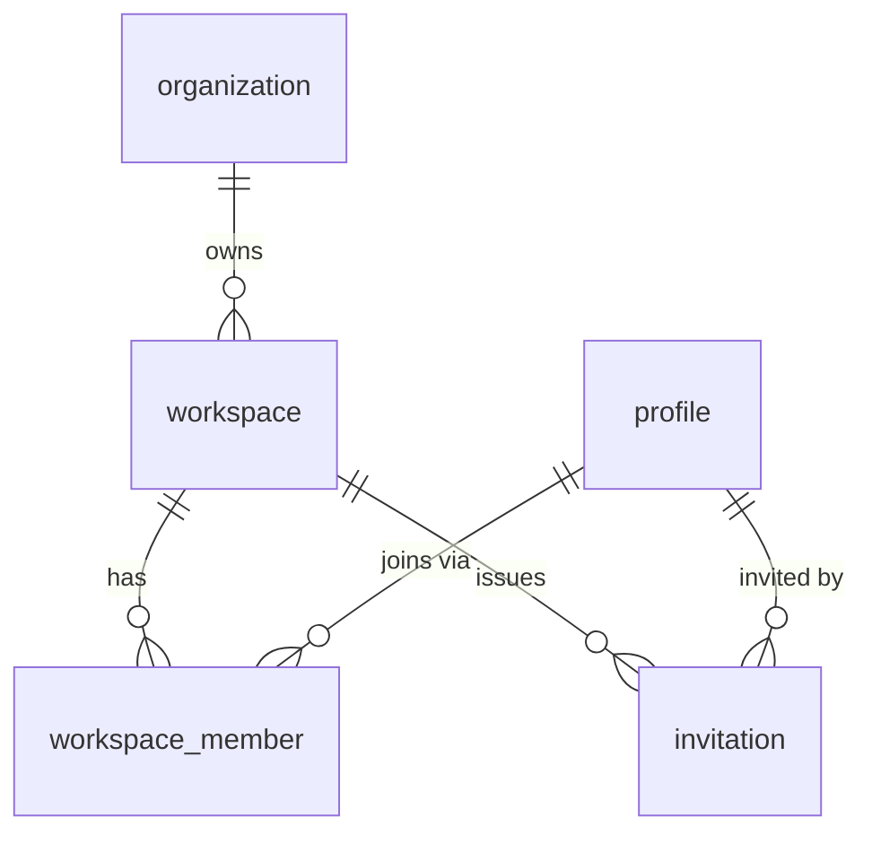
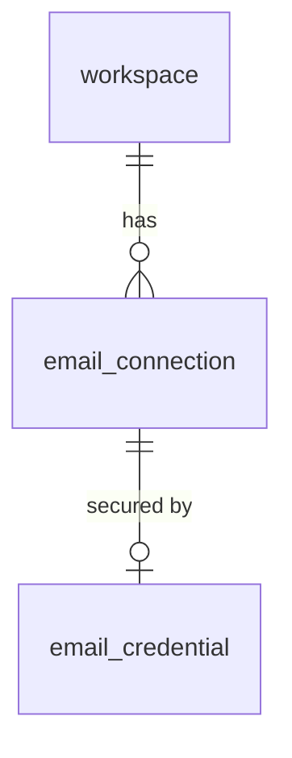
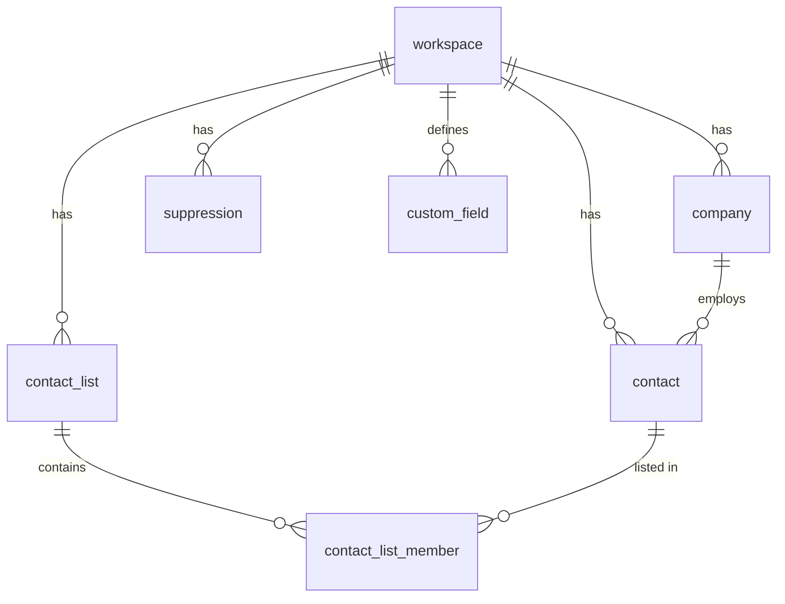
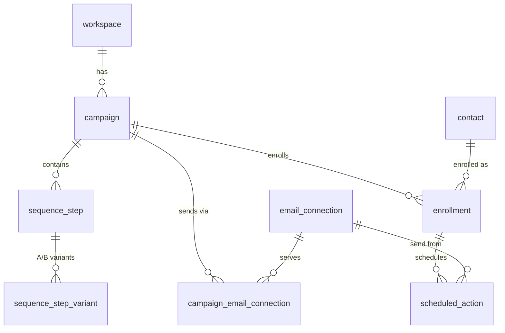
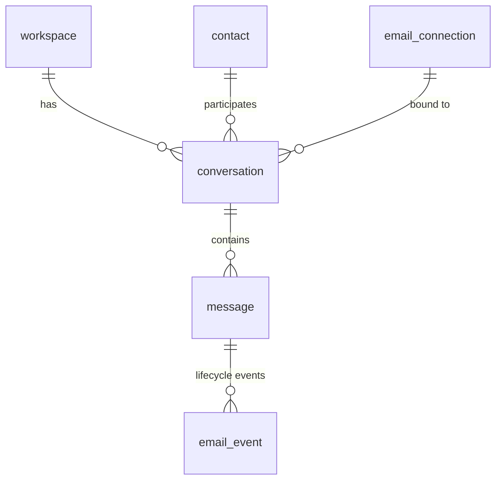
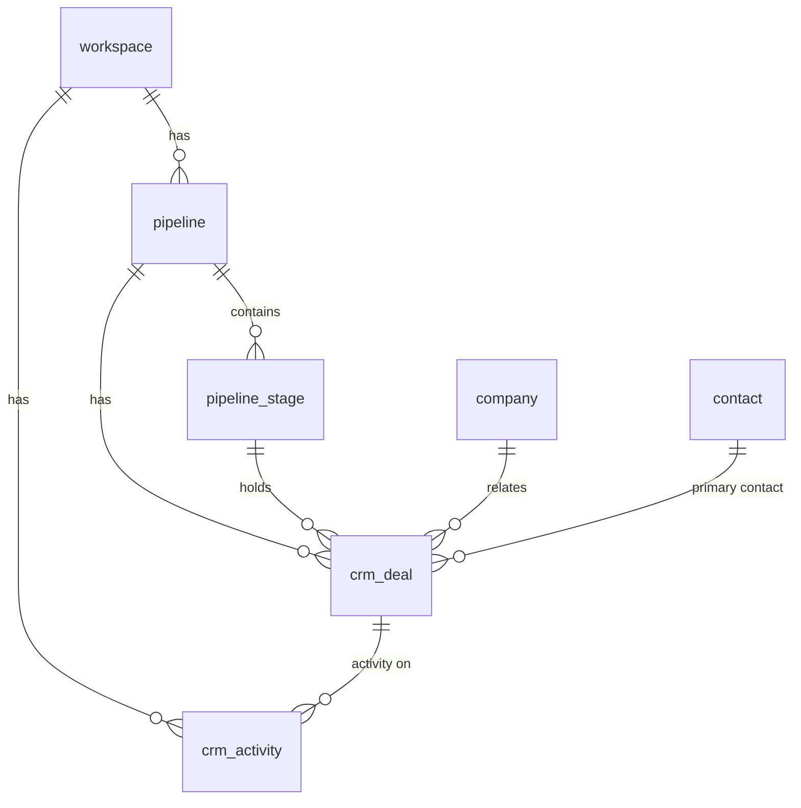
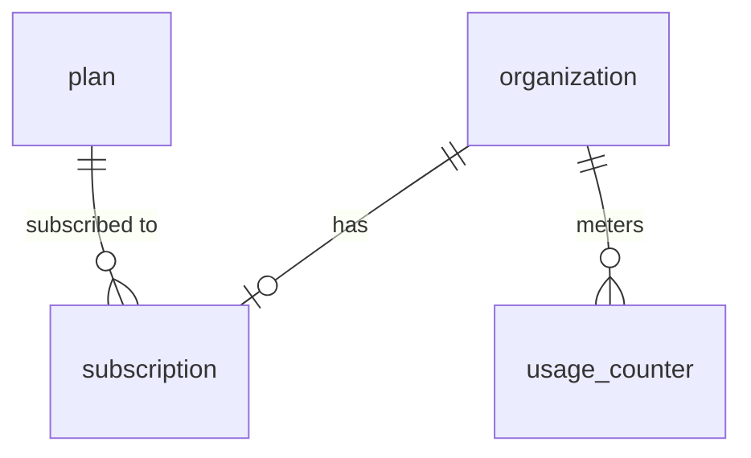

# Arcadence — Database

> Status: **Design complete (Phase 0.2).** No SQL migrations exist yet; the first migrations in Phase 0.3 implement the foundational tables below. This file is the binding schema design: ERD, entity catalog, enums, tenancy/RLS model, and indexing strategy. Concrete DDL lives only in `supabase/migrations/` — never in console changes.

**Last updated:** 2026-10-10

---

## 1. Platform & access

- Supabase PostgreSQL (hosted). The Scala services are long-lived JVM processes → **direct connections** (port 5432) or **session pooling** where routing requires it. Transaction pooling (port 6543, Supavisor) may be used for short-lived request paths only; in that mode prepared statements are disabled (`prepareThreshold=0`) and no cross-transaction session state is assumed (ADR-0018 records the choice).
- Schema changes happen **only** through version-controlled SQL migrations in `supabase/migrations/` (workflow in §3 / ADR-0018). No dashboard SQL-editor changes, no undocumented production changes.
- Primary keys: `id uuid primary key default gen_random_uuid()` unless the entity is a 1:1 mirror of an `auth.users` row (then PK = the auth user id).

## 2. Tenancy model (ADR-0017)

- **organization** — the billing/legal owner (an agency or a company). Owns Stripe subscriptions and plan limits.
- **workspace** — the tenant isolation unit. Every business entity carries `workspace_id`. A workspace always belongs to exactly one organization. (Matches the outreach product's mental model: agencies run many client workspaces.)
- **workspace_member** — a user's membership in a workspace with a role (`owner | admin | member | viewer`).
- **profile** — 1:1 mirror of `auth.users` (same UUID PK) for display data. Auth itself lives in Supabase Auth.

## 3. Migration conventions (ADR-0018)

- Location: `supabase/migrations/` — `<UTC-timestamp>_<snake_case_name>.sql` (Supabase CLI ordering).
- **Single workflow, tool-enforced:** local development runs the Supabase CLI stack (`supabase start`, migrations via `supabase db reset`); new migrations are generated with `supabase db diff -f <name>` against reviewed changes; staging/production are updated with `supabase db push` from CI using a stored access token. The Supabase dashboard GitHub App integration is **not** used — migrations land through PRs like all code.
- **Forward-only.** Destructive migrations require explicit product-owner approval and are called out in the implementation report.
- Every migration updates this file and `docs/HANDOFF.md`.
- RLS: **enabled on every tenant table** before it is considered merged (§9).

## 4. Table conventions (binding)

| Concern | Convention |
| --- | --- |
| Tenancy | Every tenant-owned table has `workspace_id uuid not null references public.workspace (id)` — first-class, indexed |
| Timestamps | `created_at timestamptz not null default now()`, `updated_at timestamptz not null default now()` + `updated_at` trigger |
| Soft delete | `deleted_at timestamptz null` where audit history matters; hard delete only where privacy requires |
| RLS | Enabled on every tenant table; policies via helper functions (§9) |
| Indexes | Every FK indexed; composite indexes led by `workspace_id` for tenant-scoped queries |
| Constraints | Domain invariants in the schema (CHECK / FK / UNIQUE), not only in Scala |
| Naming | `snake_case`; tables singular; booleans `is_/has_` prefixed |
| Enums | Postgres `ENUM` types for closed sets (catalog in §8) |

---

## 5. Domain map

| Domain | Tables | Owner module |
| --- | --- | --- |
| Identity & tenancy | `profile`, `organization`, `workspace`, `workspace_member`, `invitation` | `workspaces` / `identity` |
| Email connections | `email_connection`, `email_credential` | `emailconnections` |
| Contacts & lists | `company`, `contact`, `custom_field`, `contact_list`, `contact_list_member`, `suppression` | `leads` |
| Campaigns | `campaign`, `campaign_email_connection`, `sequence_step`, `sequence_step_variant`, `enrollment`, `scheduled_action` | `campaigns` |
| Messaging & inbox | `conversation`, `message`, `email_event` | `inbox` / `sending` |
| Analytics | `campaign_stats_daily` | `analytics` |
| CRM | `pipeline`, `pipeline_stage`, `crm_deal`, `crm_activity` | `crm` |
| AI | `ai_generation` | `ai` |
| Billing | `plan`, `subscription`, `usage_counter` | `billing` (org-scoped) |
| Platform | `job_queue`, `audit_log`, `webhook_endpoint`, `webhook_delivery` | `platform` |

## 6. ERD & entity catalog

### 6.1 Identity & tenancy



| Table | Purpose | Key columns | Unique / constraints | Indexes |
| --- | --- | --- | --- | --- |
| `profile` | Display data for auth users | `id` (= auth.users.id, PK), `display_name`, `avatar_url` | PK = auth id | — |
| `organization` | Billing/legal owner | `id`, `name`, `stripe_customer_id` | — | `(stripe_customer_id)` |
| `workspace` | Tenant isolation unit | `id`, `organization_id` FK, `name`, `slug`, `timezone`, `daily_send_cap` | `unique(organization_id, slug)` | `organization_id` |
| `workspace_member` | Membership + role | `id`, `workspace_id` FK, `user_id` (= auth.users.id), `role workspace_role` | `unique(workspace_id, user_id)` | `user_id` |
| `invitation` | Pending member invites | `id`, `workspace_id` FK, `email`, `role`, `token`, `invited_by`, `expires_at`, `accepted_at` | `unique(token)`, `unique(workspace_id, lower(email))` where not accepted | `workspace_id`, `email` |

### 6.2 Email connections



| Table | Purpose | Key columns | Unique / constraints | Indexes |
| --- | --- | --- | --- | --- |
| `email_connection` | Gmail / Microsoft / SMTP-IMAP sending+receiving account | `id`, `workspace_id` FK, `provider email_provider`, `email_address`, `display_name`, `status connection_status`, `auth_error text`, `daily_send_cap`, `is_default bool` | `unique(workspace_id, lower(email_address))` | `(workspace_id, status)` |
| `email_credential` | Encrypted secrets, 1:1 with connection | `id`, `email_connection_id` FK unique, `kind oauth2|password`, `encrypted_blob bytea`, `encryption_key_version int`, `expires_at` (token expiry) | unique(connection) | — |

Encrypted columns are written only by the Scala server (envelope encryption; key management in `docs/SECURITY.md` §4). Never exposed to the browser or logs.

### 6.3 Contacts & lists



| Table | Purpose | Key columns | Unique / constraints | Indexes |
| --- | --- | --- | --- | --- |
| `company` | Account/company record | `id`, `workspace_id` FK, `name`, `domain`, `industry`, `size` | `unique(workspace_id, lower(domain))` where domain not null | `(workspace_id, name)` |
| `contact` | Lead/person record | `id`, `workspace_id` FK, `company_id` FK null, `email`, `first_name`, `last_name`, `title`, `phone`, `timezone`, `custom_fields jsonb`, `verification_status contact_verification`, `state contact_state` | `unique(workspace_id, lower(email))` | `(workspace_id, state)`, `(workspace_id, company_id)` |
| `custom_field` | Custom field definitions per workspace | `id`, `workspace_id` FK, `key`, `label`, `type field_type` | `unique(workspace_id, key)` | — |
| `contact_list` | Static lead lists | `id`, `workspace_id` FK, `name` | `unique(workspace_id, lower(name))` | — |
| `contact_list_member` | List membership | `id`, `list_id` FK, `contact_id` FK, `added_at` | `unique(list_id, contact_id)` | `contact_id` |
| `suppression` | Do-not-contact list (checked on every send path) | `id`, `workspace_id` FK, `value` (email), `reason suppression_reason`, `source suppression_source` | `unique(workspace_id, value)` | `(workspace_id, reason)` |

### 6.4 Campaigns



| Table | Purpose | Key columns | Unique / constraints | Indexes |
| --- | --- | --- | --- | --- |
| `campaign` | Outreach campaign | `id`, `workspace_id` FK, `name`, `status campaign_status`, `timezone`, `send_window_start time`, `send_window_end time`, `send_on_weekdays bool[]`, `daily_cap`, `open_tracking bool`, `click_tracking bool`, `created_by` (= auth.users.id) | `unique(workspace_id, lower(name))` | `(workspace_id, status)` |
| `campaign_email_connection` | Sending accounts assigned to campaign | `id`, `campaign_id` FK, `email_connection_id` FK, `priority int` | `unique(campaign_id, email_connection_id)` | `email_connection_id` |
| `sequence_step` | Step in campaign sequence | `id`, `campaign_id` FK, `position int`, `type step_type` (email/wait), `wait_days int` (wait steps) | `unique(campaign_id, position)` | — |
| `sequence_step_variant` | A/B subject/body variants | `id`, `step_id` FK, `position int`, `weight int` (0–100 CHECK), `subject`, `body` | `unique(step_id, position)` | — |
| `enrollment` | Contact progressing through a campaign | `id`, `workspace_id` FK, `campaign_id` FK, `contact_id` FK, `list_id` FK null (source), `status enrollment_status`, `current_step int`, `next_action_at timestamptz`, `started_at`, `finished_at` | `unique(campaign_id, contact_id)` | `(workspace_id, status)`, `(status, next_action_at)` |
| `scheduled_action` | Durable work item (send email, …) | `id`, `workspace_id` FK, `enrollment_id` FK, `campaign_id` FK, `contact_id` FK, `email_connection_id` FK, `type action_type`, `run_after timestamptz`, `status action_status`, `attempts int`, `idempotency_key`, `payload jsonb`, `locked_at`, `locked_by`, `last_error` | `unique(idempotency_key)` | partial `(run_after) where status = 'pending'`, `(enrollment_id)` |

Claiming uses `FOR UPDATE SKIP LOCKED` on the partial index (ADR-0005). `scheduled_action` rows are never deleted for completed sends (audit); retention job archives old `done` rows.

### 6.5 Messaging & inbox



| Table | Purpose | Key columns | Unique / constraints | Indexes |
| --- | --- | --- | --- | --- |
| `conversation` | Thread with a contact | `id`, `workspace_id` FK, `contact_id` FK, `email_connection_id` FK, `subject`, `status conversation_status`, `last_message_at`, `unread_count int` | `unique(workspace_id, contact_id, email_connection_id, subject_hash)` *(hash of normalized subject)* | `(workspace_id, last_message_at desc)` |
| `message` | One email in a thread | `id`, `workspace_id` FK, `conversation_id` FK, `email_connection_id` FK, `contact_id` FK, `campaign_id` FK null, `enrollment_id` FK null, `direction message_direction`, `status message_status`, `provider_message_id`, `internet_message_id`, `in_reply_to`, `subject`, `body_text`, `body_html`, `headers jsonb`, `sent_at`, `size_bytes` | `unique(email_connection_id, provider_message_id)`, `unique(email_connection_id, internet_message_id)` | `(conversation_id, sent_at)`, `(workspace_id, status)` |
| `email_event` | Append-only lifecycle events (analytics source of truth) | `id`, `workspace_id` FK, `message_id` FK, `campaign_id` FK null (denormalized), `contact_id` FK null, `type email_event_type`, `occurred_at`, `provider email_provider` null, `details jsonb` (SMTP code, bounce sub-type, IP, user-agent) | — | `(message_id, occurred_at)`, `(campaign_id, type, occurred_at)` |

### 6.6 Analytics

| Table | Purpose | Key columns | Unique / constraints | Indexes |
| --- | --- | --- | --- | --- |
| `campaign_stats_daily` | Pre-aggregated per-campaign daily counters (materialized by worker from `email_event`) | `id`, `workspace_id` FK, `campaign_id` FK, `day date`, counters: `sent`, `delivered`, `bounced_hard`, `bounced_soft`, `opened`, `clicked`, `replied`, `unsubscribed`, `complained` | `unique(campaign_id, day)` | `(workspace_id, day)` |

### 6.7 CRM



| Table | Purpose | Key columns | Unique / constraints | Indexes |
| --- | --- | --- | --- | --- |
| `pipeline` | Sales pipeline | `id`, `workspace_id` FK, `name` | `unique(workspace_id, lower(name))` | — |
| `pipeline_stage` | Stage in pipeline | `id`, `pipeline_id` FK, `name`, `position int`, `probability int` CHECK 0–100 | `unique(pipeline_id, position)` | — |
| `crm_deal` | Opportunity | `id`, `workspace_id` FK, `pipeline_id` FK, `stage_id` FK, `company_id` FK null, `contact_id` FK null, `name`, `value_cents bigint`, `currency char(3)`, `status deal_status`, `expected_close_on date`, `stage_position int` | — | `(workspace_id, status)`, `(stage_id, stage_position)` |
| `crm_activity` | Notes/calls/meetings/tasks; also links campaign emails into the timeline | `id`, `workspace_id` FK, `deal_id` FK null, `contact_id` FK null, `company_id` FK null, `message_id` FK null (linked email), `type activity_type`, `body`, `due_at`, `completed_at`, `created_by` | — | `(deal_id, created_at)`, `(contact_id, created_at)` |

### 6.8 AI

| Table | Purpose | Key columns | Unique / constraints | Indexes |
| --- | --- | --- | --- | --- |
| `ai_generation` | Audit + result of every AI-assisted action (no silent AI writes) | `id`, `workspace_id` FK, `user_id` (= auth.users.id), `kind ai_kind` (campaign_copy, reply_draft, lead_summary, …), `model`, `prompt_context jsonb` (redacted of secrets), `output text`, `tokens_in`, `tokens_out`, `status ai_status` (succeeded/failed) | — | `(workspace_id, created_at)` |

### 6.9 Billing (org-scoped — no `workspace_id`)



| Table | Purpose | Key columns | Unique / constraints | Indexes |
| --- | --- | --- | --- | --- |
| `plan` | Static plan catalog (seeded) | `id`, `code`, `name`, `max_workspaces`, `max_email_accounts`, `max_contacts`, `emails_per_day`, `ai_credits_monthly` | `unique(code)` | — |
| `subscription` | Stripe subscription mirror | `id`, `organization_id` FK, `plan_id` FK, `stripe_customer_id`, `stripe_subscription_id`, `status subscription_status`, `current_period_end` | `unique(stripe_subscription_id)` | `organization_id` |
| `usage_counter` | Metered usage for limit enforcement | `id`, `organization_id` FK, `workspace_id` FK null, `metric`, `period text` (e.g. `2026-10`), `value bigint` | `unique(organization_id, metric, period, workspace_id)` — nullable-safe via expression index on `coalesce(workspace_id, '000…')` | — |

### 6.10 Platform

| Table | Purpose | Key columns | Unique / constraints | Indexes |
| --- | --- | --- | --- | --- |
| `job_queue` | Generic durable jobs (ADR-0005) — retries, backoff, `SKIP LOCKED` claiming | `id`, `queue`, `payload jsonb`, `run_after`, `status action_status` (shared state machine), `attempts`, `max_attempts`, `locked_at`, `locked_by`, `last_error` | — | partial `(run_after) where status = 'pending'`, `(queue, status)` |
| `audit_log` | Append-only security-relevant actions (members, credentials, exports, deletions) | `id`, `workspace_id` FK null (platform-level events), `actor` (= auth.users.id null for system), `action`, `target_type`, `target_id`, `metadata jsonb`, `ip inet` | — | `(workspace_id, created_at desc)`, `(actor, created_at)` |
| `webhook_endpoint` | Customer-registered outbound webhook | `id`, `workspace_id` FK, `url`, `secret_enc bytea`, `events text[]`, `is_active bool` | — | `(workspace_id)` |
| `webhook_delivery` | Outbound delivery attempt ledger (at-least-once, HMAC-signed) | `id`, `workspace_id` FK, `webhook_endpoint_id` FK, `event_type`, `payload jsonb`, `status action_status`, `response_status int`, `attempts`, `next_retry_at` | — | `(status, next_retry_at)` |

---

## 7. Enum catalog

| Enum | Values |
| --- | --- |
| `workspace_role` | owner, admin, member, viewer |
| `email_provider` | gmail, microsoft, smtp_imap |
| `connection_status` | connected, auth_error, syncing, paused, disconnected |
| `contact_verification` | unknown, valid, risky, invalid |
| `contact_state` | active, unsubscribed, complained, bounced |
| `field_type` | text, number, date, boolean, url |
| `suppression_reason` | bounce, complaint, unsubscribe, manual, invalid |
| `suppression_source` | automatic, import, manual |
| `campaign_status` | draft, active, paused, completed, archived |
| `step_type` | email, wait |
| `enrollment_status` | pending, active, paused, completed, replied, unsubscribed, bounced, failed, skipped |
| `action_type` | send_email, generic_job |
| `action_status` | pending, claimed, done, failed, cancelled |
| `message_direction` | outbound, inbound |
| `message_status` | queued, sending, sent, delivered, deferred, bounced, failed, unknown, received |
| `conversation_status` | open, closed, archived |
| `email_event_type` | queued, sent, delivered, deferred, bounced_hard, bounced_soft, complained, opened, clicked, replied, unsubscribed, send_failed, received |
| `activity_type` | note, call, meeting, task, email_linked |
| `ai_kind` | campaign_copy, reply_draft, lead_summary, other |
| `ai_status` | succeeded, failed |
| `subscription_status` | trialing, active, past_due, canceled |

---

## 8. State machines → schema

Canonical state machines live in `docs/ARCHITECTURE.md` §7. Schema mapping:

- `campaign.status` — transitions validated in Scala; `draft → active`, `active ⇄ paused`, `active → completed`, terminal `archived`.
- `enrollment.status` — drives `next_action_at`; terminal states (`completed, replied, unsubscribed, bounced, failed, skipped`) set `finished_at`.
- `scheduled_action.status` / `job_queue.status` / `webhook_delivery.status` — shared `action_status` machine (`pending → claimed → done | failed`, `cancelled` terminal) with `attempts`/`last_error`; unknown outcomes (SMTP timeout) end as `failed` **with** an `email_event` of type `send_failed`+details or a deliberate `unknown` marker on the message — never silently assumed delivered.
- `message.status` — per-message lifecycle mirroring `email_event` progression; append-only events are the source of truth, `status` is a cache for queries.

---

## 9. Tenancy enforcement & RLS design

**Defense in depth** (Scala-side checks are the gate; RLS is the backstop):

1. **Scala API**: every request resolves `user → workspace_member(role)` for the addressed `workspaceId`; queries are always composed with an explicit `workspace_id` predicate. No Scala query runs without tenant scoping (enforced by repository-layer types + isolation tests).
2. **RLS helper functions** (created in 0.3, `security definer`, `search_path` locked):

   ```sql
   create function public.current_user_id() returns uuid …;         -- from auth.jwt() ->> 'sub'
   create function public.is_workspace_member(w uuid) returns boolean …;
   create function public.workspace_role(w uuid) returns workspace_role …;  -- for RBAC policies
   ```

3. **Policy pattern** per tenant table: `select` for members (viewer+), `insert/update` for member+, `delete` for admin+; sensitive tables (credentials, suppression, billing) tighten to admin+. Service-role bypasses RLS and is used only in enumerated server jobs (`docs/SECURITY.md` §3).
4. **Cross-tenant isolation tests** are mandatory per resource (ADR-0011) — a resource without them is not done.

---

## 10. Indexing strategy summary

- All FKs indexed; tenant queries lead with `workspace_id`.
- Hot paths get dedicated indexes now, not after profiling: due-work scans `scheduled_action (run_after) where status='pending'`; inbox `conversation (workspace_id, last_message_at desc)`; provider sync uniqueness on `(email_connection_id, provider_message_id)`; analytics `(campaign_id, type, occurred_at)` on `email_event`.
- `lower(email)` / `lower(domain)` expression uniques where case-insensitivity is semantic.
- Every index added in a migration carries a comment naming the query it serves.

## 11. Verification checklist per migration

1. `up` applied to a fresh local database without errors; rollback strategy stated (forward fix).
2. RLS enabled + policies present for any new tenant table.
3. Indexes match the query patterns of the subphase that needs them.
4. Cross-tenant isolation test added/updated and passing.
5. This file and `docs/HANDOFF.md` updated.
